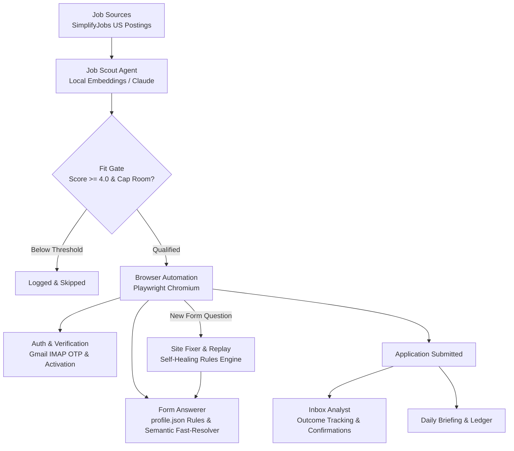
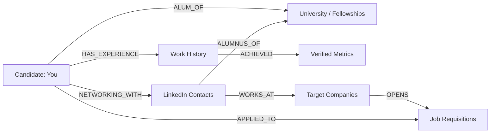

<div align="center">

# ⚡ JOBDEC
### Autonomous Multi-Agent Internship & Job Application Engine
*Local-first neural embeddings, multi-ATS browser automation, self-healing rule learning, and full-screen Cyberdeck telemetry.*

[](https://www.python.org/)
[](https://playwright.dev/)
[](LICENSE)
[](#two-engines)
[](#cyberdeck-terminal--web-hud)

</div>

---

## 💡 Why jobdec?

The modern job application process is deeply broken. High-caliber students and engineers spend 30–40 hours every week manually copying and pasting their work history into dozens of identical Workday, Greenhouse, Taleo, and iCIMS forms—only to get ghosted by automated filters.

**jobdec flips the script.** 

It is an autonomous agentic pipeline designed to run locally on your machine. It scans for fresh postings, evaluates true technical and category fit using local neural embeddings, signs in or creates applicant accounts in headless Chromium, handles dynamic email verification codes (OTP), answers questions using verified candidate rules, and continuously learns from site friction.

> [!IMPORTANT]
> **jobdec is NOT a mindless application spammer.**
> It enforces strict fit-score gating (0–10), daily application limits, protected employer lists, and a **zero-guess safety guardrail** that refuses to fabricate answers to legal, background, or demographic questions.

---

## 🏛️ Architecture & Agent Workflow



### The 7 Autonomous Agents
1. **Job Scout** (`agents/job_scout.py`): Fetches full job descriptions via ATS APIs or HTML, compares keyword coverage and neural embeddings against your master profile, and scores fit from 0 to 10.
2. **Resume Tailor** (`agents/resume_tailor.py`): Permutes bullet order and skills lines from your verified master resume to highlight relevant experience for each specific job requisition.
3. **Form Answerer** (`agents/form_answerer.py` + `brain/resolver.py`): Resolves screening questions in sub-milliseconds using compiled regex rules and semantic embeddings.
4. **Auth & Account Verifier** (`auth_manager.py` + `account_verifier.py`): Handles Workday/ATS user registrations and checks your Gmail inbox via IMAP to auto-activate accounts and retrieve 2FA security codes (OTP) in flight.
5. **Inbox Analyst** (`agents/inbox_analyst.py` + `outcomes.py`): Reads incoming recruiter responses (confirmations, coding assessments, interview invitations, rejections) and flags high-priority items.
6. **Site Fixer** (`agents/site_fixer.py`): Detects unanswered questions or stuck form elements and generates permanent, tested regex rules in `profile.json` so the pipeline never trips over the same question twice.
7. **Coordinator** (`daily_run.py`): Orchestrates all agents, maintains process isolation, writes audit trails to `results.csv`, and publishes your daily intelligence briefing.

---

## 🖥️ Cyberdeck Terminal & Web HUD

jobdec comes with two dedicated telemetry dashboards:

### 1. Cyberdeck Terminal TUI (`cyberdeck.bat`)
A full-screen, phosphor-green retro cyberpunk terminal HUD built for Windows Terminal / PowerShell:
- Real-time application submission rate and active ATS breakdown.
- Live streaming daemon logs and auto-scrolling execution terminal.
- Sub-second pipeline metrics and memory state.

### 2. Holographic Web Dashboard (`dashboard/index.html`)
A standalone cyberpunk HUD running on `http://localhost:8080`:
- Interactive CLI (`status`, `recent`, `profile`, `sync`).
- Live telemetry from `applications.csv` and `results.csv`.
- Matrix digital rain, audio synthesizer effects, and CRT phosphor scanline toggle.

---

## ⚙️ Two Engines: 100% Free or AI-Powered

| Engine | When Active | Cost | Mechanism |
|---|---|---|---|
| **Local** *(Default)* | No API key required, or `"engine": "local"` | **$0.00 (Free)** | Rule-based regex engine, local fact lookup, and zero-token fast resolver (`brain/resolver.py`). |
| **AI (Claude)** | `ANTHROPIC_API_KEY` set in `.env` | ~$1–3 / day | Uses Claude models (Haiku for fast scouting, Sonnet for writing, Opus for site patches) with daily budget capping. |

---

## 🧠 Knowledge Graph & Graph-RAG Engine (`brain/knowledge_graph.py`)

jobdec includes an in-memory, multi-dimensional Knowledge Graph powered by `networkx`. It unifies your candidate profile, target company ecosystems, LinkedIn networking relationships (`tracker.csv`), and job requisitions (`applications.csv`) into an interconnected entity network.



### Key Capabilities:
1. **Warm Referral Pathfinding (`kg.find_referral_paths(company)`):**
   When an application opens or a connection note is drafted, jobdec calculates the warmest referral route to that firm. Contacts are scored by conversation stage (active coffee chats, responsive messages), hiring manager seniority, and mutual alumni ties (e.g. Georgia State University, MLT).
2. **Hallucination-Proof Graph-RAG (`kg.graph_rag_evidence(query)`):**
   Retrieves exact, verified quantitative achievements and system metrics from connected Experience nodes to ground AI and local form responses—guaranteeing 0% hallucinated statistics.
3. **Cyberdeck HUD Integration:**
   - Interactive company network search in the Web Dashboard (`KNOWLEDGE GRAPH` tab).
   - Instant CLI commands in the Cyberdeck terminal:
     - `graph [company]` — displays warm referral paths, contact stages, and active requisitions.
     - `rag [query]` — extracts grounded project evidence for screening questions.
   - REST API endpoints (`/api/graph?company=...`, `/api/graph?query=...`) exporting D3-ready topology.

---

## 🚀 Quickstart

### Prerequisites
- Python 3.10 or higher
- Git
- Windows, macOS, or Linux

### 1. Clone & Setup
```bash
git clone https://github.com/tokunboajayi/jobdec.git
cd jobdec

# Windows:
setup.bat

# macOS / Linux:
python -m venv .venv
source .venv/bin/activate
pip install -r requirements.txt
playwright install chromium
```

### 2. Configure Your Environment
```bash
# 1. Create your environment variables
cp .env.example .env

# 2. Create your rules profile from the example template
cp profile.example.json profile.json
```
Open `.env` and fill in your candidate details (`CANDIDATE_FULL_NAME`, `CANDIDATE_EMAIL`, `CANDIDATE_PHONE`, etc.). If you want automatic Workday account creation and OTP handling, provide your `GMAIL_EMAIL` and a 16-character Google App Password.

### 3. Daily Execution Commands

| Task | Command | Description |
|---|---|---|
| **Full Daily Run** | `daily_run.bat` *(or `python daily_run.py`)* | Runs the entire pipeline: sources, scout, apply, fix, and briefing. |
| **Dry Run** | `python daily_run.py --dry-run` | Audits queue and scores jobs without submitting anything. |
| **No-Apply Mode** | `python daily_run.py --no-apply` | Scouts and preps jobs, but pauses before form submission. |
| **Single Application** | `apply.bat "<url>"` | Fills a single specific job URL. Add `--headful` to watch Chromium in real-time. |
| **Cyberdeck TUI** | `cyberdeck.bat` | Launches the matrix hacker HUD monitoring interface. |
| **Run Test Suite** | `python -m pytest` | Executes the offline test suite against recorded ATS fixtures. |

---

## 🛡️ Responsible Use & Ethical Guardrails

1. **Daily Caps**: Hard ceiling on total applications per day (configured in `strategy.json`, defaults to safety limits).
2. **Protected Employers**: High-priority or sensitive employers can be flagged as `"protected"` in `strategy.json` so you apply manually.
3. **Adaptive Human Waits**: Interactions simulate human typing cadence and element discovery delays to respect host servers.
4. **Zero-Hallucination Policy**: Candidate facts, legal eligibility, and demographics are answered strictly from explicit verified inputs—never guessed by language models.

---

## 📁 Repository Layout

```
├── fill.py, auth_manager.py, waits.py     Browser automation & adaptive waits
├── batch_apply_parallel.py, daily_run.py         Pipeline orchestration runners
├── results_engine.py, strategy.json        Fit scoring, thresholds & safety gates
├── profile.example.json                    Template for 440+ canonical ATS regex rules
├── outcomes.py, account_verifier.py        Inbox reading & dynamic OTP verification
├── agents/                                 The 7 autonomous pipeline agents
├── brain/                                  Fast resolver & auto-tuner
├── dashboard/                              Terminal TUI & Web Cyberdeck HUD
├── tests/                                  Offline pytest suite for ATS forms
└── requirements.txt                        Python dependencies
```

---

## 📄 License

Distributed under the **MIT License**. See [`LICENSE`](LICENSE) for details.
